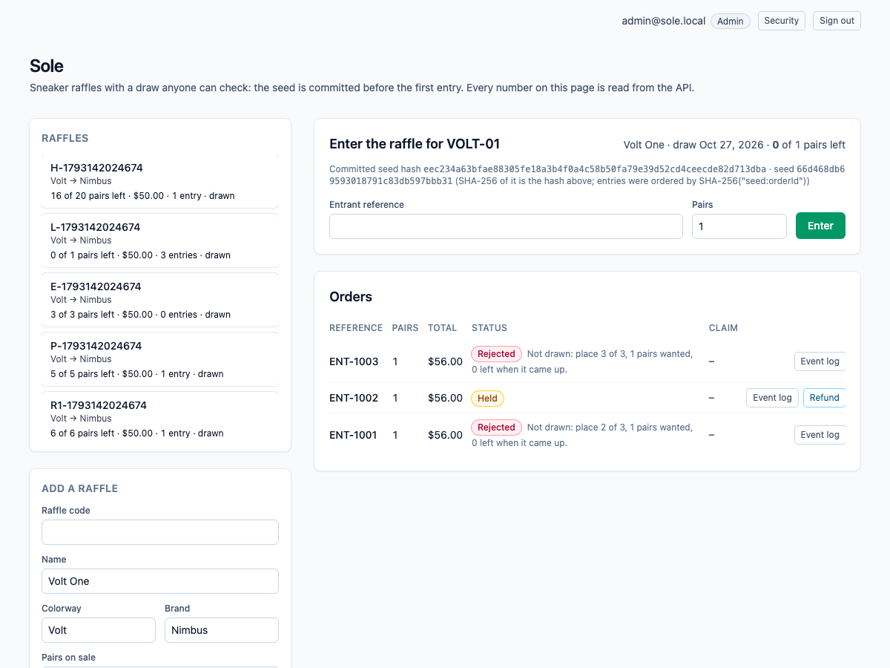
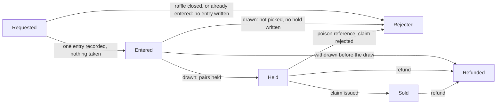
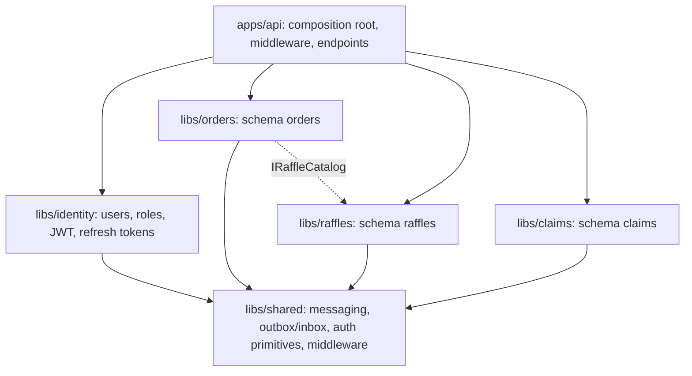

# dotnet-sole

Sneaker raffles with a draw anyone can check. Entering a raffle takes no stock: it only records one entry per person. At the draw time a drawer in the Raffles module (every API instance runs one) hands the pairs out, and the order it uses was **committed before the first entry existed**. When the raffle opens, the server picks a random seed and publishes only its SHA-256 (`seedHash`). At the draw the entries are ordered by `SHA-256("seed:orderId")` ascending and the pairs are given out first fit; the seed is then revealed, and anyone can hash it, compare it with the commitment, and recompute every rank (`GET /api/raffles/{code}/draw` returns the seed and each entry's key and rank). The draw runs in one transaction behind a conditional `UPDATE` that flips the raffle from `Open` to `Drawn`, so several instances drawing at once draw it exactly once, and it locks the entries it draws (`FOR UPDATE`), so a withdrawal racing the draw either lands first and the entry is not drawn, or lands after and releases the pairs it won: every pair is on the shelf or held, once. Winners get a hold and go through the usual saga; the others are told "Not drawn: place N of M". A reference that contains the poison token `POISON` is committed as rejected by the Claims module, the message is dead-lettered, and a compensating command gives the pairs back. A later refund does the same, but it does not roll back the claim that was already issued.

One ASP.NET Core process, one Postgres database. An HTTP write saves the order and an outbox row in one local transaction; a `BackgroundService` relay publishes outbox rows to RabbitMQ (the work queue) and Kafka (the event log); the next module consumes from RabbitMQ, claims an inbox key in the same transaction as its own write, and writes its own row and outbox row. Saga steps never call each other in-process. Delivery is at-least-once: the relay can publish and crash before it marks a row sent, so the row goes out again, and every consumer dedupes with its inbox key. Each saga step only moves an order forward from the status it expects.

Everything behind the saga is signed in: **ASP.NET Core Identity** with **JWT access tokens and rotating refresh tokens** (see [Authentication and authorization](#authentication-and-authorization)). Customers see and refund only their own orders; staff see everything and open raffles.

> The demo credentials in `compose.yaml` and `appsettings.Development.json` are for local use only. Set `JWT_KEY` and `ADMIN_PASSWORD` (see `.env.example`) before putting this anywhere shared. Compose binds every port to `127.0.0.1`.



*The UI reads everything from the API; shown signed in as the seeded administrator, after a draw: the committed hash and the revealed seed are shown side by side, the winner of the single pair was sold, and the other entrants were told their place in the order.*

## Order statuses



`Refunded` and `Rejected` (after a hold) put the pairs back through a `ReleasePairs` command, and Raffles releases a hold at most once. Withdrawing an entry before the draw just deletes it; after the draw it releases the pairs the entry won, once, and a losing entry has nothing to release. The claim has its own status (`Issued` or `Rejected`) and a refund never changes it. If the refund gets there before the final mark, the late mark finds the order is no longer `Held` and does nothing.

## How the modules talk

```mermaid
sequenceDiagram
    participant C as Client
    participant O as Orders
    participant T as Raffles
    participant E as Claims

    C->>O: POST /api/orders
    Note over O: order + outbox row, one transaction
    O-->>C: 202 Requested
    O->>T: pairs.reserve (relay → RabbitMQ, copy to Kafka)
    alt the raffle is open and this is the person's first entry
        Note over T: inbox claim, INSERT ... ON CONFLICT DO NOTHING on (raffle, person), outbox row
        T->>O: pairs.entered (Requested → Entered): no pairs are taken yet
    else closed, or already entered
        T->>O: pairs.short (Requested → Rejected, reason Closed or Already entered)
    end
    Note over T: at the draw time, every instance's drawer tries to claim the raffle (Open → Drawn); one wins
    Note over T: lock the entries, order by SHA-256(seed:orderId), hand out pairs first fit, reveal the seed
    alt the entry won
        T->>E: pairs.held
        T->>O: pairs.held (Entered → Held)
        alt reference is clean
            Note over E: claim, outbox row
            E->>O: claim.issued (Held → Sold)
        else reference contains POISON
            Note over E: committed Rejected, then the message is dead-lettered
            E->>T: pairs.release (compensating command)
            E->>O: claim.rejected (Held → Rejected)
            T->>O: pairs.released
        end
    else the entry was not picked
        T->>O: pairs.short (Entered → Rejected, no hold, "Not drawn: place N of M")
    end
    C->>O: POST /api/orders/{id}/refund
    O->>T: pairs.release (Entered, Held or Sold → Refunded)
    T->>O: pairs.released
```

| Module | Owns | Consumes | Emits |
| --- | --- | --- | --- |
| **Identity** (`libs/identity`) | `identity` schema: users, roles, refresh tokens. | | |
| **Orders** (`libs/orders`) | `Orders`: status, pairs, total, entrant reference. Validation, the poison rule, the total. | `pairs.entered`, `pairs.held`, `pairs.short`, `claim.issued`, `claim.rejected`, `pairs.released` | `pairs.reserve`, `pairs.release` (refund) |
| **Raffles** (`libs/raffles`) | `Raffles.PairsLeft` (sole writer after the raffle opens), the committed `Seed`/`SeedHash`, `RaffleEntries` (one per person per raffle, with the outcome and rank the draw wrote) and `PairHolds`. | `pairs.reserve`, `pairs.release` (prefetch 1) | `pairs.entered`, `pairs.held`, `pairs.short`, `pairs.released` |
| **Claims** (`libs/claims`) | `Claims`. | `pairs.held` | `claim.issued`, `claim.rejected`, `pairs.release` (poison) |
| **Shared** (`libs/shared`) | The relay, the consumer loop with retry and dead-letter, the Kafka log, auth primitives, middleware. Each module owns its own `OutboxMessages` and `InboxMessages` tables. | | |

RabbitMQ topology is declared in code (`libs/shared/Messaging/Topology.cs`): exchange `sole.work`, one queue per module (`raffles.commands`, `claims.work`, `orders.events`), a `.retry` queue per module (2 s TTL, then back to the main queue, 3 attempts), and a `.dlq` per module behind `sole.dlx`. A transient failure retries; a poison message goes straight to the dead-letter queue after its rejection is committed. Kafka has one topic, `sole.events`, one partition, replication factor 1, keyed by order id.

## Architecture

One deployable (`apps/api`), several libraries. Each business module is its own class library with its own `DbContext`, its own Postgres **schema** (`identity`, `orders`, `raffles`, `claims`), its own migrations and its own outbox and inbox tables. No module references another; the only shared code is `Sole.Shared`, and the one cross-module read (a raffle's existence and pricing inputs) goes through an interface, `IRaffleCatalog`, that Raffles implements and Orders consumes.



Modules still talk only through messages: RabbitMQ carries the commands, Kafka keeps the event log, and the outbox and inbox make delivery at-least-once and consumption idempotent.

## Authentication and authorization

| Piece | How it works |
| --- | --- |
| Accounts | ASP.NET Core Identity. Passwords need 10+ characters with upper case, lower case and a digit, and 4 distinct characters. Five wrong passwords (or codes) lock the account for 15 minutes (`429`). A wrong password and an unknown email give the same `401`. |
| Email | Registration mails a confirmation link; with `Auth:RequireConfirmedEmail` on (the default) sign-in is refused (`403`) until it is opened. "Forgot password" mails a one-time reset link and answers `202` for every address, known or not. Messages go through `IAuthMailer`: SMTP when `Mail:Host` is set, the log otherwise. The demo stack also keeps them in a dev mailbox at `/api/dev/mailbox` (off by default). Link tokens are protected with data-protection keys stored in Postgres, so every instance and every restart can read them. |
| Two-factor | TOTP (any authenticator app): `POST /api/auth/mfa/setup` returns the key and an `otpauth://` URI, `enable` proves it with a code and returns eight one-time recovery codes, `disable` needs the password and a code. Once on, sign-in needs a code (`401 A verification code is required.`). |
| Access token | JWT, 15 minutes, held **in memory** by the Angular app and sent as `Authorization: Bearer`. HS256 with a key of at least 32 bytes, or **RS256** when `Jwt:RsaPrivateKeyPem` is set, in which case the public key is served at `/.well-known/jwks.json` so other services can verify tokens without a secret. The API refuses to start without an usable key. |
| Revocation | Each token carries the user's session version. A password change, a reset, turning two-factor off and **"sign out everywhere"** bump it (one atomic `UPDATE`), and every token sold earlier stops working on every instance within `Jwt:RevocationCacheSeconds` (default 5). |
| Refresh token | 256 random bits in an `HttpOnly`, `SameSite=Strict`, `Path=/api/auth` cookie (`Secure` over HTTPS). Only its SHA-256 is stored. Every refresh **rotates** it with a conditional `UPDATE`, so two concurrent refreshes with the same token cannot both win. Presenting a token that was already used revokes the whole family. Refresh and logout also need an `X-Requested-With: sole-web` header, so another site cannot trigger them. |
| Roles | `Customer` (default at registration), `Staff`, `Admin`. An administrator is seeded from configuration on first start. |
| Rules | Anonymous: `/api/health`, `/api/auth/*`. Any signed-in user: read raffles, book, read and refund **their own** orders and claims. `Staff` and `Admin`: open raffles, read everything, read the event log. Another user's order or claim is `404`, not `403`, so ids do not leak. The owner of an order is the caller; a body field cannot set it. |
| Messaging | The outbox is drained by any number of relays at once (`FOR UPDATE SKIP LOCKED`, so no row is published twice at the same time) and trimmed on a schedule. Staff can look inside the dead-letter queues and replay them from the API. |
| Hardening | A rate limit on `/api/auth/*` per client (`RateLimit:AuthPerMinute`), **counted in Postgres** so every API instance shares one count, security headers on every response (`nosniff`, `DENY`, strict CSP, `no-referrer`), a correlation id echoed in `X-Correlation-Id` and in every problem response, JSON logs (`Logging:Json`), forwarded headers only when `ForwardedHeaders:Enabled`, a fallback policy that makes every endpoint authenticated unless it opts out, and a readiness endpoint that checks every module schema. |

## Run it

Needs Node 22 (npm 10), .NET SDK 10.0.401 (`global.json`), Docker (arm64 is fine) and python3 for the smoke script.

```bash
npm ci
dotnet test tests/Sole.UnitTests   # 125 tests, no Docker
docker compose up -d --wait db        # the integration tests use Postgres on 5487 (database sole_test)
docker compose exec db createdb -U sole sole_test   # once
dotnet test tests/Sole.IntegrationTests
docker compose up --build --wait      # db, kafka, rabbitmq, api, web
./scripts/smoke.sh                    # last line: sole smoke passed
npx playwright install chromium       # once
npx playwright test                   # the browser specs against http://127.0.0.1:8107
docker compose down                   # keeps the Postgres volume; `down -v` raffles it
```

| Service | Host port |
| --- | --- |
| Web (nginx, proxies `/api/`) | 8107 |
| API (`/scalar/v1`, `/api/health`) | 5227 |
| Postgres 17 | 5487 |
| Kafka 3.8.1 (KRaft, one broker) | 9137 |
| RabbitMQ 3.13 / management UI (`platform` / `platform`) | 5717 / 15717 |

Inside the Compose network the API and nginx listen on 8080 and Kafka's internal listener is 9092.

## Try it with curl

The web app is at <http://127.0.0.1:8107> (`admin@sole.local` / `SoleAdmin2026` in the demo stack, or register a customer). From the shell:

```bash
API=http://127.0.0.1:5227
login() { curl -s -X POST $API/api/auth/login -H 'content-type: application/json' -d "{\"email\":\"$1\",\"password\":\"$2\"}" | python3 -c 'import sys,json; print(json.load(sys.stdin)["accessToken"])'; }
ADMIN="Authorization: Bearer $(login admin@sole.local SoleAdmin2026)"

curl -s -X POST $API/api/auth/register -H 'content-type: application/json' \
  -d '{"email":"ana@example.com","password":"Passw0rd-Demo1"}'      # 201; its accessToken goes in $ANA below
ANA="Authorization: Bearer <accessToken>"

DRAW_AT=$(python3 -c 'import datetime; print((datetime.datetime.now(datetime.timezone.utc)+datetime.timedelta(minutes=2)).strftime("%Y-%m-%dT%H:%M:%SZ"))')
curl -s -H "$ADMIN" -X POST $API/api/raffles \
  -H 'content-type: application/json' \
  -d "{\"code\":\"VOLT-01\",\"name\":\"Volt One\",\"colorway\":\"Volt\",\"brand\":\"Nimbus\",\"pairsTotal\":2,\"priceCents\":8000,\"drawAt\":\"$DRAW_AT\"}"
# the response shows seedHash (the commitment) and seed: null until the draw

curl -s -H "$ANA" -X POST $API/api/orders \
  -H 'content-type: application/json' \
  -d '{"raffleCode":"VOLT-01","reference":"ENT-1001","pairs":1}'
# 202, status Requested, then Entered: nothing is taken yet. One entry per person per raffle. Use the returned id.

curl -s -H "$ANA" $API/api/orders/<id>               # Entered now; after the draw: Sold (with a claim number) or Rejected ("Not drawn: place 3 of 7")
curl -s -H "$ANA" $API/api/raffles/VOLT-01/draw      # after the draw: the seed, whether it matches the hash, and your entry's key and rank
curl -s -H "$ANA" $API/api/claims/<id>
curl -s -H "$ADMIN" $API/api/orders/<id>/events        # the Kafka log for this order

curl -s -H "$ANA" -X POST $API/api/orders/<id>/refund \
  -H 'content-type: application/json'                       # before the draw: withdraws the entry; after it: the pairs go back, the claim stays
```

To check a draw yourself: `sha256(seed)` must equal the `seedHash` you saw when the raffle opened; each entry's key is `sha256("<seed>:<orderId>")`; sort the keys ascending and give pairs out in that order, each entry taking its pairs if they still fit. That reproduces every outcome.

An order is validated at the door: entrant reference required (at most 40 characters), 1 to 6 pairs. The draw time must be in the future when the raffle opens, and entries after it are refused (409, or `Closed` if one slips through a race). A second entry by the same person is accepted at the door and rejected by the raffle with `Already entered`. The poison match is a case-sensitive substring: `ENT-POISON-7` and any longer token containing `POISON` match.

## Develop with Nx

The repository is an Nx workspace (`nx.json`, plugin `@nx/dotnet`). `npx nx show projects` lists `api`, `web`, the four libraries and both test projects.

```bash
docker compose up -d --wait db kafka rabbitmq   # the brokers and Postgres, not the app
npx nx serve api                                # http://localhost:5227 (Development: seeded admin, public docs)
npx nx serve web                                # http://localhost:4307, proxies /api to the API
WEB_URL=http://localhost:4307 npx playwright test   # the same browser specs, against the dev servers
npx nx run-many -t typecheck lint -p web        # tsc --noEmit and ESLint (angular-eslint)
npx nx build web && npx nx build api            # what CI builds
```

## What is tested, and where it runs

- **Unit tests** (`tests/Sole.UnitTests`, 133 tests, no Docker, about 3 seconds): the **draw** (the commitment is the SHA-256 of the seed, the order does not depend on how entries arrive, another seed gives another order, winners never take more than the pairs, first fit lets a smaller entry win after a bigger one fails, and across 4,000 seeds each of 20 entrants wins about 25% of the time for 5 pairs), the order rules and fee, the poison rule including integer overflow, token creation and validation, password and lockout behaviour of the auth service on an in-memory store, owner-or-staff access, the retry policy and topology, message serialization, the outbox `DbContext` conventions, and the HTTP middleware (problem details are `application/problem+json`, security headers, correlation ids).
- **Integration tests** (`tests/Sole.IntegrationTests`, 71 tests, real Postgres): the **raffle** (entering takes no stock and gives one entry per person; entries after the draw time are refused; the draw writes outcomes and holds exactly as the recomputable order says; a draw before its time does nothing and a raffle is drawn once; five instances drawing at once draw it once; withdrawing before the draw removes the entry; a winner gives its pairs back once and a loser has nothing to give; eight rounds of withdrawals racing the draw never lose or double-count a pair), and the check constraints behind them; the saga handlers against the real schema (duplicate delivery claimed once, a release returns the pairs once, the poison rejection committed before the dead-letter, refund then late final mark); and the **whole HTTP pipeline** through `WebApplicationFactory`: register, login, wrong password, lockout, expired and tampered tokens, refresh rotation, replay revoking the family, two concurrent refreshes (exactly one wins), logout, a missing `X-Requested-With` header, the auth rate limit, and 401/403/404 for every route and ownership case. The racing-withdrawal test caught a real bug while it was written: loading the entries without locking let a withdrawal delete a row between the draw reading it and writing its outcome; the draw now locks them with `FOR UPDATE`.
- **`scripts/smoke.sh`** drives the composed stack: authentication and ownership first (401, 403, 404), then validation (including a draw time in the past), the happy path (enter with nothing taken, the draw runs by itself, sold, the seed matches its commitment, Kafka log), a one-pair draw with three entrants (one sold, two "Not drawn", recomputed from the seed), one entry per person, withdrawing and a late entry (409), the poison reference (it wins the draw, rejected, `claims.work.dlq` gains one message, pairs restored), and a refund that lands between the claim and the final mark. To make that last window wide enough to hit on purpose, Compose sets `Orders__FinalMarkDelayMs=1500`; it is a latency knob and defaults to 0. Compose also sets `Raffles__DrawIntervalMs=500` so draws follow their time quickly.
- **Playwright** (`e2e/specs`, 15 tests, Chromium): `auth.spec.ts` (anonymous sees only the form, wrong password, password policy, a customer enters and sees only their own orders with no staff controls, sign-out, the session surviving a reload through the cookie while `document.cookie` stays empty); `enter-raffle.spec.ts` (open a raffle, enter, the draw runs by itself, claim, reload, refund); `ui-flows.spec.ts` (refusal messages and one entry per person, a poison entry that wins and is rejected, a draw checked end to end: the revealed seed hashes to the commitment and the winner is the lowest key, withdrawing before the draw, the Kafka event log). They run against the composed web port and against the Nx dev servers.
- **CI** (`.github/workflows/ci.yml`) has two jobs. `verify`: `npm ci`, Prettier check, `dotnet format whitespace --verify-no-changes`, unit tests, integration tests (Postgres 17 service) with coverage uploaded, a NuGet vulnerability check, `npm audit`, `nx typecheck` and `nx lint` for web (zero warnings allowed) and `nx build`. `e2e`: builds the Compose stack, runs the smoke and every Playwright spec, and uploads traces and prints logs on failure. Dependabot watches NuGet, npm, Actions and Docker.

## Cloud mapping

This repository runs on Compose. Nothing in it calls a cloud account.

| Here | On AWS |
| --- | --- |
| Postgres 17 | RDS for PostgreSQL |
| Kafka 3.8 | MSK |
| RabbitMQ 3.13 | Amazon MQ, or SQS with a dead-letter queue |
| The API and the web app | ECS or App Service |
| JWT signing key and seeded admin | Secrets Manager, injected as environment variables |

## API

JSON over HTTP. Everything except health and `/api/auth/register|login|refresh|logout` needs a bearer token. Interactive docs are at `http://127.0.0.1:5227/scalar/v1` (OpenAPI at `/openapi/v1.json`) when `Docs:Public` is true, which Compose and Development set; otherwise they need a staff token.

| Method and path | What it does | Responses |
| --- | --- | --- |
| `GET /api/health`, `GET /api/health/ready` | Liveness; readiness (every module schema reachable). | `200`, `503` |
| `POST /api/auth/register` | Creates a customer and mails a confirmation link. Signs them in unless confirmation is required. | `201` signed in, `202` check your inbox, `400` policy, `409` email taken, `429` |
| `POST /api/auth/login` | Signs in (with `code` when two-factor is on); sets the refresh cookie. | `200`, `401`, `403` unconfirmed, `429` locked or rate limited |
| `POST /api/auth/refresh`, `POST /api/auth/logout` | Rotate or revoke the refresh cookie. Need `X-Requested-With: sole-web`. | `200`/`204`, `400` header missing, `401` |
| `POST /api/auth/confirm-email`, `resend-confirmation` | Confirm an address with the emailed token; ask for a new link (always `202`). | `204`/`202`, `400` |
| `POST /api/auth/forgot-password`, `reset-password` | Mail a reset link (always `202`); set a new password with it (ends every session). | `202`/`204`, `400` |
| `POST /api/auth/change-password`, `logout-everywhere` | Signed in: change the password (ends the other sessions and returns a fresh one); end every session on every device. | `200`/`204`, `400`, `401` |
| `GET /api/auth/mfa`, `POST /api/auth/mfa/setup`, `enable`, `disable` | Two-factor status and lifecycle (see above). | `200`/`204`, `400`, `409` |
| `GET /.well-known/jwks.json` | The public key set when RS256 is on. | `200`, `404` |
| `GET /api/auth/me` | The caller. | `200`, `401` |
| `POST /api/raffles` | Opens a raffle with its pairs, a price in cents and a draw time in the future. Staff. The server picks the seed and shows only `seedHash` until the draw. | `201`, `400` invalid, `403`, `409` code exists |
| `GET /api/raffles`, `GET /api/raffles/{code}` | Raffles with the live pairs left, the entry count, the status (`Open`/`Drawn`), `seedHash`, and `seed` once drawn. | `200`, `404` |
| `GET /api/raffles/{code}/draw` | What it takes to check a draw: the seed, whether it matches the hash, the totals, and the caller's own entries with their key, rank and outcome (staff: every entry). | `200`, `401`, `404` |
| `POST /api/orders` | Enters the raffle for the caller (1 to 6 pairs) and starts the saga. The entry takes no pairs; the draw decides. | `202` Requested, `400` invalid, `404` unknown raffle, `409` duplicate reference or the draw time has passed |
| `GET /api/orders?raffleCode=&page=&pageSize=` | The caller's orders, newest first, a page at a time (`pageSize` at most 100, default 100). Staff: everyone's. The total is in `X-Total-Count`. | `200` |
| `GET /api/orders/{id}` | One order and its status. Owner or staff. | `200`, `404` |
| `POST /api/orders/{id}/refund` | Moves an entered, held or sold order to `Refunded`: withdraws the entry before the draw, or puts the pairs back after it. The claim is not touched. Owner or staff. | `202`, `404`, `409` wrong status |
| `GET /api/orders/{id}/events` | The Kafka event log for one order. Staff. | `200`, `403` |
| `GET /api/admin/dead-letters`, `POST /api/admin/dead-letters/{queue}/replay` | What waits in each dead-letter queue, with the first messages; publish them again. Staff. A message that still fails for the same reason is dead-lettered again. | `200`, `403`, `503` brokers off |
| `GET /api/claims/{orderId}` | The claim row. Owner or staff. | `200`, `404` |

Errors come back as `application/problem+json` with a `title` and the `correlationId`.

## Configuration

Compose sets these on the API container. Defaults in `apps/api/appsettings.json` point at the published host ports, so `nx serve api` works against `docker compose up -d --wait db kafka rabbitmq`.

| Setting | Compose value | Meaning |
| --- | --- | --- |
| `ConnectionStrings__Sole` | `Host=db;Port=5432;Database=sole;Username=sole;Password=sole` | The one Postgres database. Migrations run on startup. |
| `RabbitMq__Host` / `__Port` / `__User` / `__Password` | `rabbitmq` / `5672` / `platform` / `platform` | Work queue. Virtual host `/`. |
| `Kafka__BootstrapServers` | `kafka:9092` | Event log. |
| `Jwt__Key` | `${JWT_KEY}` or a demo key | HS256 signing key, at least 32 bytes. Required; startup fails without it. |
| `Jwt__AccessMinutes` / `__RefreshDays` / `__SecureCookies` | `15` / `14` / `false` | Token lifetimes; set `SecureCookies` when TLS ends in front of the API. |
| `Identity__SeedAdmin__Email` / `__Password` | `${ADMIN_EMAIL}` / `${ADMIN_PASSWORD}` | Administrator created on first start. |
| `Auth__RequireConfirmedEmail` / `Auth__PublicUrl` | `false` (demo) / `http://127.0.0.1:8107` | Sign-in waits for email confirmation (code default `true`); the address links in emails point to. |
| `Mail__Host` / `__Port` / `__User` / `__Password` / `__From` / `__StartTls` | unset | SMTP for confirmation and reset emails. Unset means the log only. |
| `Mail__DevMailbox` | `true` (demo) | Serve the last messages at `/api/dev/mailbox`. Never on in production. |
| `Jwt__RsaPrivateKeyPem` / `Jwt__KeyId` | unset | Sign with RS256 and publish the public key at `/.well-known/jwks.json`. |
| `Jwt__RevocationCacheSeconds` | `2` (code default `5`) | How long an instance trusts a cached session version before re-reading it. |
| `RateLimit__AuthPerMinute` | `120` (code default `20`) | Requests a minute per client to `/api/auth/*`. |
| `ForwardedHeaders__Enabled` | `true` | Trust `X-Forwarded-*` from the reverse proxy (nginx here). Leave off when the API is reached directly. |
| `Docs__Public` | `true` | Serve Scalar and OpenAPI without a token. |
| `Logging__Json` | `true` | Structured JSON console logs. |
| `Messaging__OutboxRetentionDays` / `Messaging__InboxRetentionDays` | `7` / `30` | Sent outbox rows and old inbox claims are deleted after this long. The inbox is kept longer because it must outlive any redelivery. |
| `Orders__FinalMarkDelayMs` | `1500` | Milliseconds the final mark waits. A latency knob so the smoke can land a refund inside the window. `0` outside Compose. |
| `Raffles__DrawIntervalMs` | `500` (code default `1000`) | How often each instance looks for raffles whose draw time has come. |
| `SOLE_TEST_DB` (tests only) | | Postgres connection for `dotnet test`. Defaults to `localhost:5487`, database `sole_test`. CI points it at its service container. |

## Look inside and fix things

```bash
docker compose ps                      # five services, all healthy
docker compose logs -f api             # relay, consumers, poison and retry lines
docker compose exec db psql -U sole -d sole -c 'select "RoutingKey","SentAt" from "OutboxMessages" order by "Id" desc limit 10'
open http://127.0.0.1:15717        # RabbitMQ management, platform / platform
```

- **Dead-lettered messages** sit in `claims.work.dlq`. Staff can list and replay them from `/api/admin/dead-letters`, or inspect them in the management UI. Retries wait in `<queue>.retry` for 2 seconds.
- **A port is already in use**: `lsof -nP -i :5227` shows who holds it. Compose publishes only on `127.0.0.1`.
- **`dotnet test` cannot connect**: start Postgres first with `docker compose up -d --wait db`.
- **The smoke cannot reach the API**: run `docker compose up --build --wait` first; override the target with `API=... RABBIT=... ./scripts/smoke.sh`.
- **Start clean**: `docker compose down -v` raffles Postgres, Kafka and RabbitMQ data. Plain `down` keeps them, and the smoke is safe on kept data because every code carries a run id.
- **The Kafka log looks empty right after an order**: the relay publishes within a second or so; reload the event log.

## Known limits

- The draw is only as fair as the one-entry-per-person rule is hard to dodge, and that rule is per account: nothing stops one person registering a second account. The seed is generated by the server and committed as a hash before any entry, so the operator cannot choose an order after seeing the entries, but the seed sits in the database until the draw, so someone with database access could read the order early; a production system would keep it in a vault or use an external randomness beacon.
- The draw runs in one transaction per raffle. That is fine for thousands of entries and not for millions. Pairs that come back after the draw (a refund, a poison rejection) go back on the shelf; they are not re-raffled to the entries that were not drawn.
- Sign-in is email and password plus optional TOTP. There are no external identity providers (Google, Microsoft) and no WebAuthn passkeys.
- Revocation is eventual by design: an instance may honour a revoked access token for up to `Jwt:RevocationCacheSeconds` seconds. Set it to `0` to check the database on every request.
- Delivery is at-least-once, not exactly-once. The inbox makes repeats harmless for the saga; the Kafka log can hold a duplicate event after a relay crash.
- Compose runs one of each broker (one Kafka partition, replication factor 1) and one API instance. The code itself is built for several API instances: the relay claims outbox rows with `FOR UPDATE SKIP LOCKED`, and the rate limit and revocation live in Postgres. A production Kafka and RabbitMQ would be clustered; that is configuration, not code.
- `GET .../events` reads the Kafka topic for one key and puts up after ten seconds, so it scans the topic. Fine here, not something to expose at scale.
- Replaying a dead letter only helps when the cause was fixed: the poison reference fails again by design.
- The browser specs drive Chromium at a desktop size only, and the `e2e` CI job needs Docker and takes a few minutes.

## Layout

```
apps/api       thin host: composition root, middleware, endpoints
apps/web       Angular 21, styled with Tailwind 4 utilities only (sign-in, role-aware workspace)
libs/shared    messaging (outbox, inbox, relay, consumers), auth primitives, middleware
libs/identity  users, roles, JWT, refresh tokens          (schema identity)
libs/orders   order rules and the saga's first step      (schema orders)
libs/raffles    the only writer of the pairs left and of the draw (schema raffles)
libs/claims claims                              (schema claims)
tests/         Sole.UnitTests, Sole.IntegrationTests
e2e/           Playwright
scripts/       smoke.sh
compose.yaml   Postgres, Kafka, RabbitMQ, API, web
```

Nx 23.2.1 orchestrates `nx build web` and `nx build api`; Each module's EF Core migrations are committed under its library and the API applies them on startup. Packages are pinned centrally in `Directory.Packages.props`, and warnings are errors (`Directory.Build.props`).

## Other systems in this .NET track

- [golang-sole](https://github.com/joshbarros/golang-sole): this system in Go on Kubernetes, with the same API and UI.
- [dotnet-freight](https://github.com/joshbarros/dotnet-freight): container space on ocean sailings.
- [dotnet-clinic](https://github.com/joshbarros/dotnet-clinic): appointment slots in a provider session.
- [dotnet-ledger](https://github.com/joshbarros/dotnet-ledger): outgoing payments from an account balance.
- [dotnet-warehouse](https://github.com/joshbarros/dotnet-warehouse): warehouse stock and outbound orders.
- [dotnet-academy](https://github.com/joshbarros/dotnet-academy): course cohort seats and enrollments.
- [dotnet-compute](https://github.com/joshbarros/dotnet-compute): GPU-hour reservations in a pool.
- [dotnet-hotel](https://github.com/joshbarros/dotnet-hotel): hotel room-nights.
- [dotnet-tickets](https://github.com/joshbarros/dotnet-tickets): event ticket tiers and orders.
- [dotnet-carbon](https://github.com/joshbarros/dotnet-carbon): carbon credit batches and purchases.
- [dotnet-charging](https://github.com/joshbarros/dotnet-charging): EV charger slot reservations.
- [dotnet-promo](https://github.com/joshbarros/dotnet-promo): limited-use promo codes and redemptions.
- [dotnet-pledge](https://github.com/joshbarros/dotnet-pledge): matched donations from a sponsor's matching pool.
- [dotnet-bistro](https://github.com/joshbarros/dotnet-bistro): table reservations with a first-come waitlist.
- [dotnet-flash](https://github.com/joshbarros/dotnet-flash): flash-sale deals with holds that expire.
- [dotnet-encore](https://github.com/joshbarros/dotnet-encore): gig seats with price steps as the gig sells.
- [dotnet-atelier](https://github.com/joshbarros/dotnet-atelier): workshop seats with an all-or-nothing laptop kit bundle.
- [dotnet-mint](https://github.com/joshbarros/dotnet-mint): limited-edition drops with a per-collector limit.
